

  <a href="https://mominul-devloper-bd.vercel.app">
    
  </a>

  
  
  
  
  
  
  

  

---

### 🎯 About Me

<table>
  <tr>
    <td width="60%" valign="top">
      
    </td>
    <td width="40%" valign="top">
      
    </td>
  </tr>
</table>

---

### 🚀 Featured Live Products & Bento Showcase

  

  
  
  
  
  

---

### 📱 Mobile & Web App UI/UX Portfolio

  
  
  
  
  
  

  <em>A curated showcase of modern, production-grade Mobile Applications, SaaS Dashboards, and UI/UX design architectures built with Flutter, Next.js, and Figma.</em>

<table>
  <!-- Row 1: AI & IoT -->
  <tr>
    <td width="50%" align="center" valign="top">
      <h3>🤖 StudyGenie — AI Student Assistant</h3>
      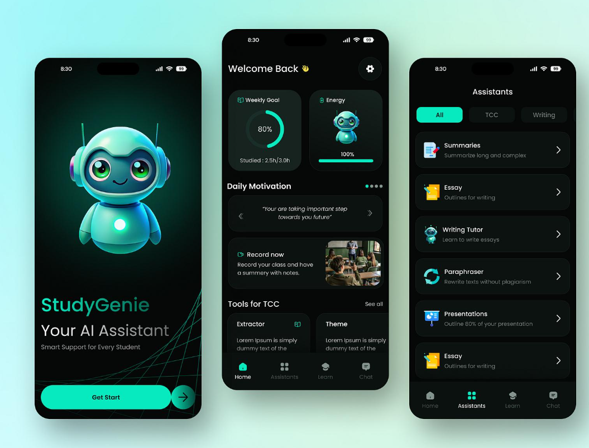
        
      

        
        
        
      

      

        <b>Features:</b> 3D robotic AI mascot, automatic lecture summarization, essay outline generator, writing tutor, and intelligent student study planner.
      

    </td>
    <td width="50%" align="center" valign="top">
      <h3>☀️ Sunlytix — Smart Solar IoT Monitor</h3>
      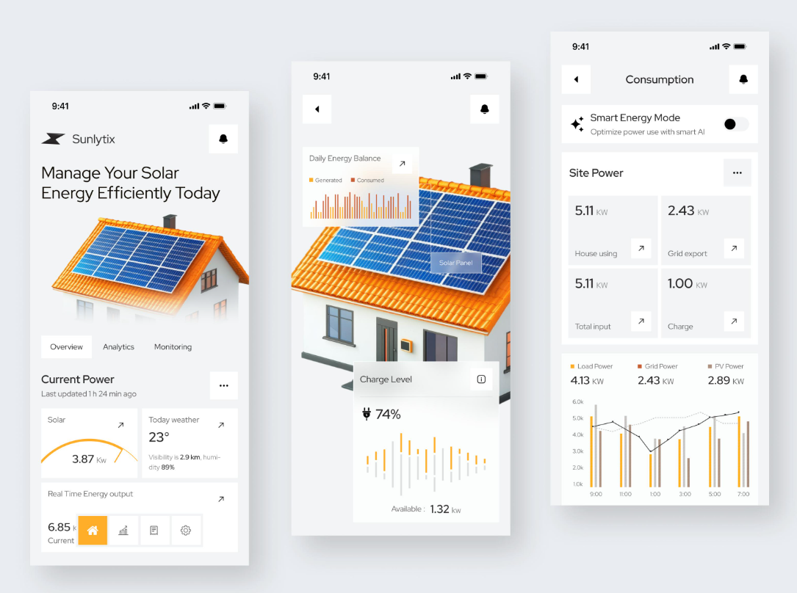
        
      

        
        
        
      

      

        <b>Features:</b> Real-time solar energy telemetry, 3D isometric home visualization, daily balance charts, battery charge tracking, and grid export optimization.
      

    </td>
  </tr>

  <!-- Row 2: SaaS & Healthcare Dashboards -->
  <tr>
    <td width="50%" align="center" valign="top">
      <h3>🏥 DocTrack — Hospital & Clinical SaaS</h3>
      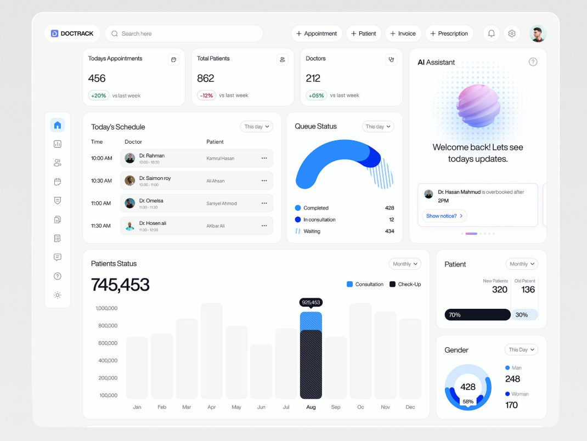
        
      

        
        
        
      

      

        <b>Features:</b> Clinical workflow management, real-time doctor appointment schedules, live patient queue monitoring, diagnostic billing, and 3D AI medical assistant.
      

    </td>
    <td width="50%" align="center" valign="top">
      <h3>📊 XCaliber — Global Supply Chain SaaS</h3>
      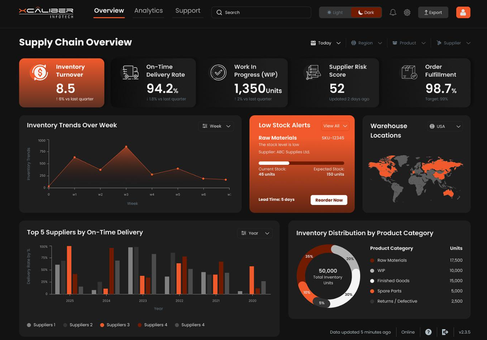
        
      

        
        
        
      

      

        <b>Features:</b> Enterprise logistics dashboard tracking on-time delivery rates, inventory turnover KPIs, low-stock predictive alerts, and multi-region warehouse distribution.
      

    </td>
  </tr>

  <!-- Row 3: On-Demand Services -->
  <tr>
    <td width="50%" align="center" valign="top">
      <h3>🛠️ FixGadget — Device Repair & Booking</h3>
      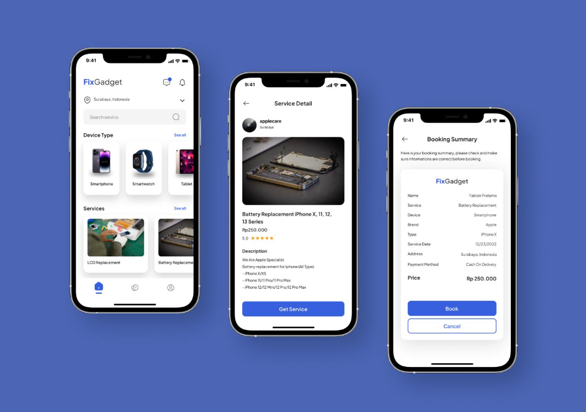
        
      

        
        
        
      

      

        <b>Features:</b> Hardware diagnostics workflow for smartphones & smartwatches, battery/LCD replacement booking, doorstep service scheduling, and instant billing summary.
      

    </td>
    <td width="50%" align="center" valign="top">
      <h3>🧹 HomeCare Pro — On-Demand Services</h3>
      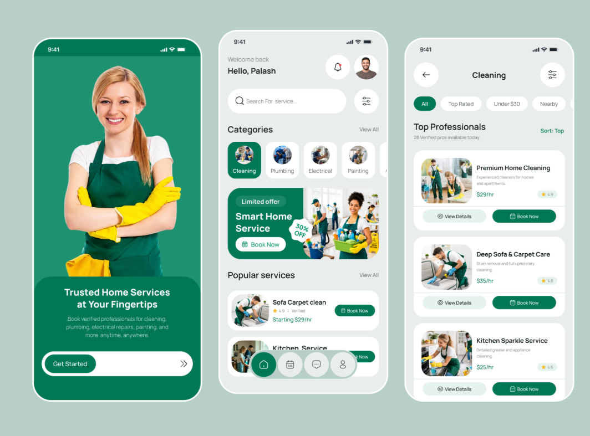
        
      

        
        
        
      

      

        <b>Features:</b> Connects homeowners with verified cleaning, plumbing, painting, and electrical experts with upfront pricing, time slot selection, and verified reviews.
      

    </td>
  </tr>

  <!-- Row 4: Eco-Tech & Smart Commerce -->
  <tr>
    <td width="50%" align="center" valign="top">
      <h3>♻️ Greencove — Smart Eco Recycling</h3>
      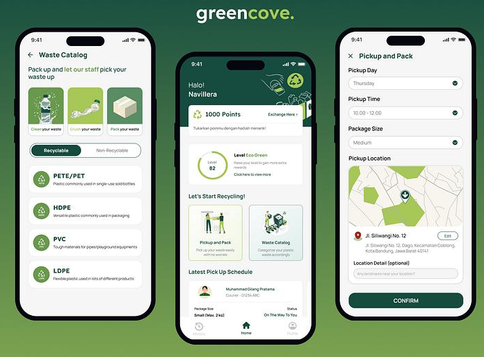
        
      

        
        
        
      

      

        <b>Features:</b> Circular economy app featuring recyclable cataloging (PET/HDPE/PVC), eco-points rewards system, and doorstep recycling pickup scheduling.
      

    </td>
    <td width="50%" align="center" valign="top">
      <h3>📺 ElectroMart — Appliances & E-Waste Hub</h3>
      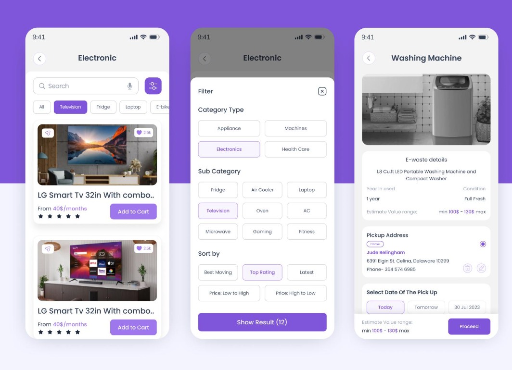
        
      

        
        
        
      

      

        <b>Features:</b> Smart electronics catalog with multi-tier category filtering, appliance monthly rental options, and integrated e-waste trade-in pickup valuation.
      

    </td>
  </tr>

  <!-- Row 5: Food Delivery & Q-Commerce -->
  <tr>
    <td width="50%" align="center" valign="top">
      <h3>🍔 Chic Burger — Food Delivery App</h3>
      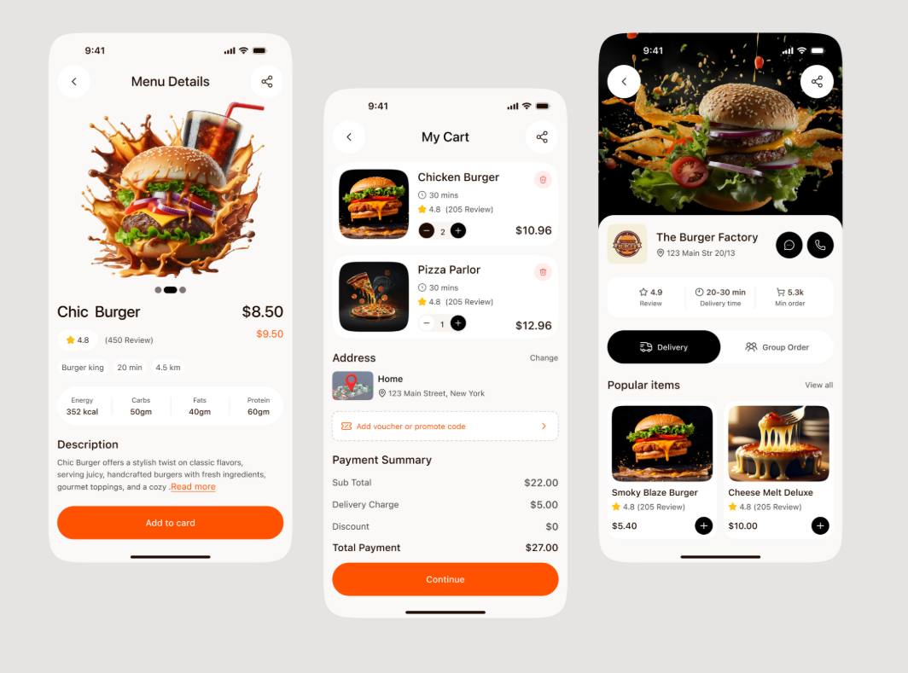
        
      

        
        
        
      

      

        <b>Features:</b> High-impact visual food presentation, caloric breakdown, customizable toppings & drinks, dynamic cart calculation, and express order dispatch.
      

    </td>
    <td width="50%" align="center" valign="top">
      <h3>🍕 Pasto Pizza — Fast Food Ordering</h3>
      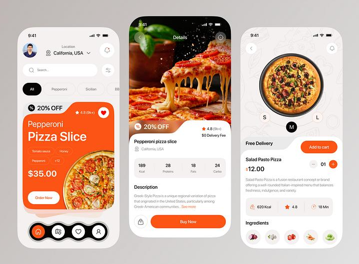
        
      

        
        
        
      

      

        <b>Features:</b> Dynamic pizza crust sizing selector (S / M / L), nutritional macronutrient display (proteins/carbs/fats), coupon discounts, and live delivery countdown.
      

    </td>
  </tr>

  <!-- Row 6: Nightlife & VIP Social -->
  <tr>
    <td width="50%" align="center" valign="top">
      <h3>🎉 NightPulse — Nightlife & Events App</h3>
      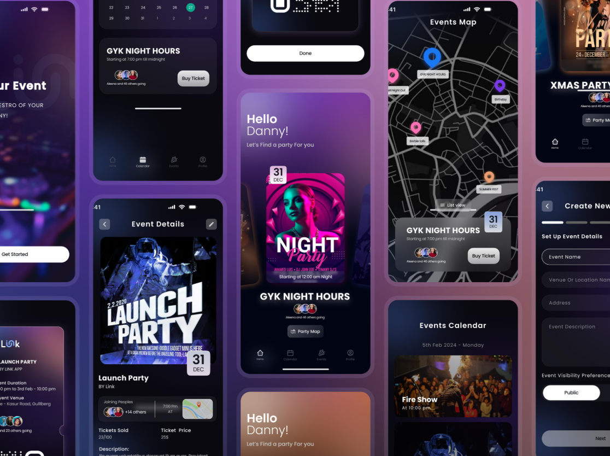
        
      

        
        
        
      

      

        <b>Features:</b> Nightlife and concert discovery platform with interactive venue map pins, RSVP launch passes, events calendar, and ticket purchasing.
      

    </td>
    <td width="50%" align="center" valign="top">
      <h3>💬 Lounge VIP — Dark & Gold Social Network</h3>
      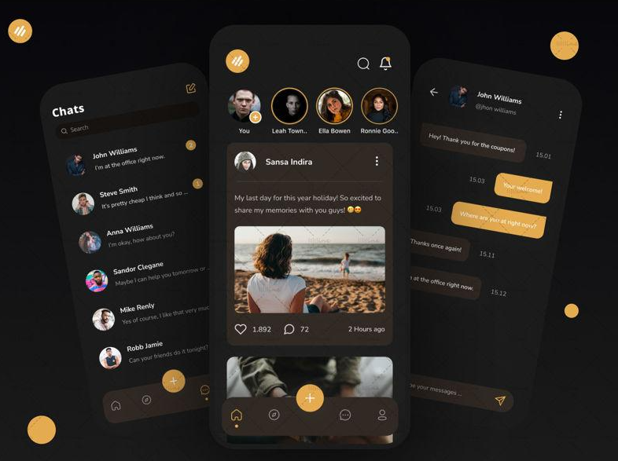
        
      

        
        
        
      

      

        <b>Features:</b> Exclusive social networking UI designed with obsidian black & warm gold accents, story moments, instant messaging threads, and media feeds.
      

    </td>
  </tr>

  <!-- Row 7: Health Tech & Logistics -->
  <tr>
    <td width="50%" align="center" valign="top">
      <h3>🌙 Zenith — Sleep & Bio-Telemetry Tracker</h3>
      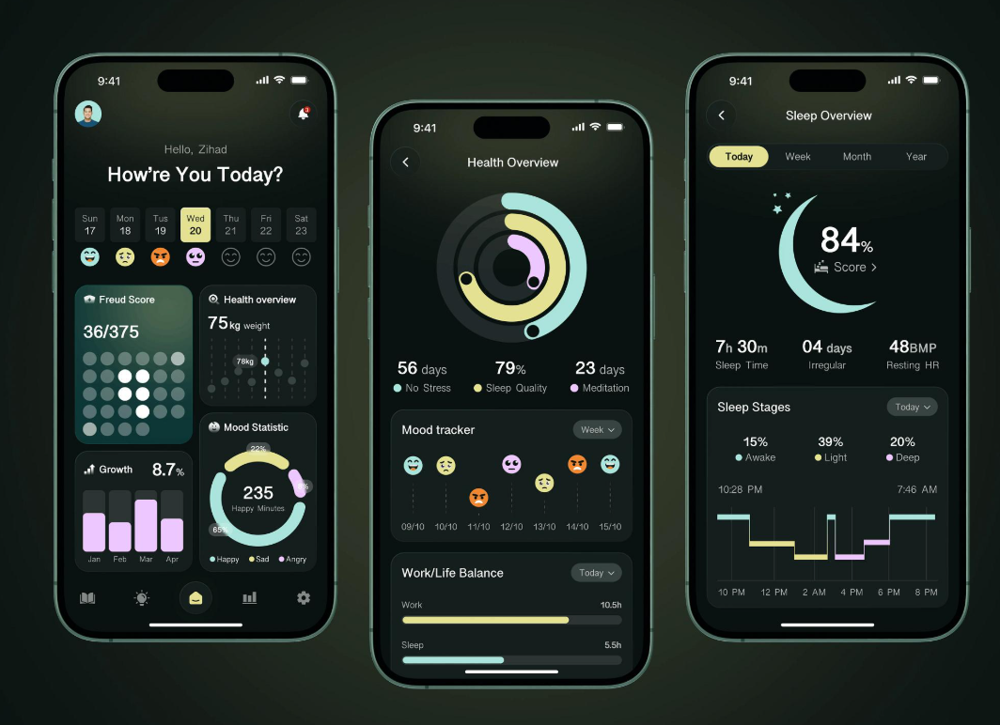
        
      

        
        
        
      

      

        <b>Features:</b> Circadian sleep stage tracking (Light, Deep, Awake), daily Freud mood scores, resting heart rate analytics, and work-life balance insights.
      

    </td>
    <td width="50%" align="center" valign="top">
      <h3>📦 Apex Logistics — Mobile Warehouse Inventory</h3>
      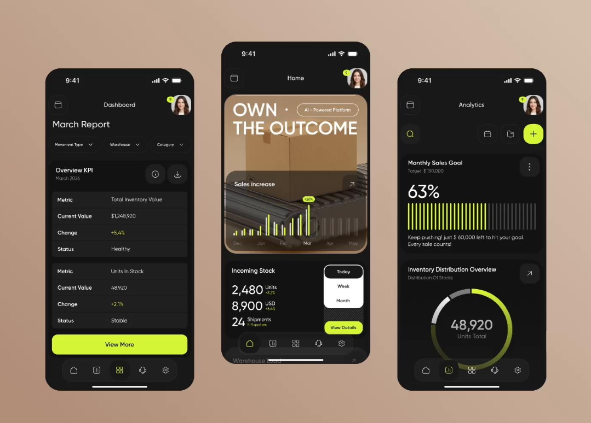
        
      

        
        
        
      

      

        <b>Features:</b> Mobile fulfillment & warehouse management showing incoming stock, monthly sales target progress, inventory distribution rings, and load capacity.
      

    </td>
  </tr>
</table>

---

### 🛠️ Tech Stack & Architecture

  

 

  
  
  
  
  

---

### 📊 GitHub Analytics

  

  
  

  
  

  

---

### 🏆 GitHub Trophies

  

---

### 🤝 Connect With Me

  
  
  
  

  

