  

  
  
  
  
  
  
  

  

---

### 🎯 About Me

<table>
  <tr>
    <td width="60%" valign="top">
      
    </td>
    <td width="40%" valign="top">
      
    </td>
  </tr>
</table>

---

### 🚀 Featured Live Products & Bento Showcase

  

  
  
  
  
  

---

### 🛠️ Tech Stack & Architecture

  

 

  
  
  
  
  

---

### 📊 GitHub Analytics

  

  
  

  
  

  

---

### 🏆 GitHub Trophies

  

---

### 🤝 Connect With Me

  
  
  
  

  

